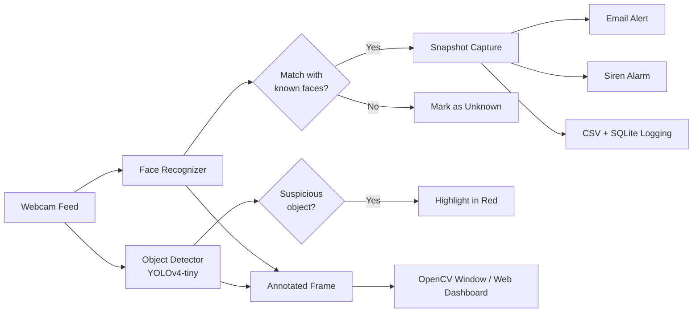

## Table of Contents

- [Overview](#overview)
- [Key Features](#key-features)
- [System Architecture](#system-architecture)
- [Tech Stack](#tech-stack)
- [Project Structure](#project-structure)
- [Getting Started](#getting-started)
- [Configuration](#configuration)
- [Usage](#usage)
- [Web Dashboard](#web-dashboard)
- [Alert System](#alert-system)
- [Logging & Storage](#logging--storage)
- [Documentation](#documentation)
- [Project Status](#project-status)
- [Author](#author)

---

## Overview

The **Smart Camera & Video Surveillance System** is an intelligent, real-time security solution that combines **face recognition** and **object detection** to monitor a live camera feed, identify known (registered) persons, flag suspicious objects, and raise multi-channel alerts.

Built as a major academic project, the system detects faces in every frame using a deep-learning face-encoding model, matches them against a database of registered individuals, and — when a known person is detected — automatically captures a snapshot, records the event, plays a siren, and sends an email alert with the snapshot attached. In parallel, a YOLOv4-tiny detector scans the feed for suspicious objects such as knives, backpacks, and suitcases.

The system can be operated in two modes:

| Mode | Entry Point | Description |
|------|-------------|-------------|
| **Terminal Mode** | `src/surveillance.py` | Native OpenCV window with interactive keyboard controls |
| **Web Dashboard Mode** | `app.py` | Flask web app with live MJPEG feed, stats, alert history, and face gallery |

---

## Key Features

- **Real-time Face Recognition** — 128-dimensional dlib face encodings matched against registered persons with a configurable confidence threshold.
- **Criminal Watchlist Matching** — Registered faces act as a watchlist; any match triggers an immediate alert pipeline.
- **Object Detection** — YOLOv4-tiny detects 80 COCO object classes; suspicious items (knife, scissors, backpack, suitcase, handbag, cell phone) are highlighted in red.
- **Email Alerts** — SMTP-based alerts with the detection snapshot attached, sent per person with a 30-second cooldown to avoid spam.
- **Siren Alarm** — A procedurally generated siren WAV is played asynchronously on every match, cross-platform (Windows / macOS / Linux).
- **Snapshot Management** — Cropped face snapshots saved per event, with automatic cleanup that retains only the most recent 50.
- **Dual Logging** — Every detection is recorded in both a CSV event log and a SQLite database.
- **Live Web Dashboard** — Flask + MJPEG streaming dashboard with detection stats, current faces/objects, alert history, and a known-faces gallery.
- **Face Registration Tools** — Interactive CLI and in-app tools to add, view, and delete registered faces, plus a dataset collector for capturing training images.
- **Thread-Safe Design** — Background video processing thread with locking on all database access, safe for the multi-threaded Flask server.

---

## System Architecture



**Processing pipeline per frame:**

1. Frame is captured from the webcam at 640x480.
2. Frame is downscaled to 25% and converted to RGB for fast face localization.
3. Each detected face is encoded (128-d vector) and compared against all registered encodings using Euclidean distance.
4. The closest match below the confidence threshold (0.4) is flagged as a **MATCH**; otherwise, the face is marked **Unknown**.
5. Every 3rd frame, YOLOv4-tiny runs object detection in parallel.
6. On a match (subject to per-person cooldown), the full alert pipeline fires: snapshot, CSV log, DB entry, email, and siren.
7. The annotated frame is rendered to the OpenCV window or streamed to the web dashboard.

---

## Tech Stack

| Component | Technology |
|-----------|-----------|
| Language | Python 3.8+ |
| Face Detection (foundation) | OpenCV Haar Cascades |
| Face Recognition | `face_recognition` (dlib) + NumPy |
| Object Detection | YOLOv4-tiny via OpenCV DNN module |
| Web Framework | Flask (Jinja2 templates, MJPEG streaming) |
| Database | SQLite 3 |
| Logging | CSV (`csv` module) |
| Email | `smtplib` + MIME (Gmail SMTP with TLS) |
| Audio | NumPy-generated WAV, platform players |
| Video I/O | OpenCV `VideoCapture` / MJPEG Response |

---

## Project Structure

```
smart-surveillance-system/
├── app.py                       # Flask web application (entry point)
├── config/
│   └── settings.py               # Central configuration & .env loader
├── src/
│   ├── face_detector.py         # Haar-cascade face detection (foundation)
│   ├── webcam_capture.py        # Webcam open/read utilities
│   ├── image_face_detection.py  # Face detection on still images
│   ├── dataset_collector.py     # Capture per-person training images
│   ├── database.py              # SQLite storage layer (thread-safe)
│   ├── face_recognizer.py       # Core: detect, encode, match, snapshot
│   ├── test_recognition.py      # Quick recognition test on an image
│   ├── register_faces.py        # Register / view / delete known faces (CLI)
│   ├── detection_logger.py      # CSV event logging and statistics
│   ├── email_alert.py           # SMTP email alerts with snapshot
│   ├── siren.py                 # Siren WAV generation and playback
│   ├── object_detector.py       # YOLOv4-tiny object detection
│   ├── surveillance.py          # Terminal-mode integrated system
│   └── dashboard.py            # Web-mode background camera thread
├── templates/
│   ├── base.html                # Dashboard layout and styles
│   ├── index.html               # Live feed + stats page
│   ├── alerts.html              # Detection history page
│   └── known_faces.html         # Registered faces gallery
├── models/
│   ├── haarcascade_frontalface_default.xml
│   ├── haarcascade_eye.xml
│   ├── yolov4-tiny.cfg
│   ├── yolov4-tiny.weights
│   └── coco.names
├── known_faces/                 # Registered face images (gitignored)
├── dataset/                     # Training dataset (gitignored)
├── snapshots/                   # Detection snapshots (auto-cleaned)
├── logs/                        # detection_log.csv + faces.db
├── sounds/                      # siren.wav (auto-generated)
├── pdf/                         # Generated project documentation
└── PROJECT_STATUS.md
```

---

## Getting Started

### Prerequisites

- Python 3.8 or later
- A webcam
- (Linux) `dlib` build requirements: `cmake`, `build-essential`
- An audio player for the siren: `aplay`, `paplay`, or `play` (Linux), `afplay` (macOS), built-in (Windows)

### Installation

1. **Clone the repository**

   ```bash
   git clone https://github.com/Ujjeef/smart-surveillance-system.git
   cd smart-surveillance-system
   ```

2. **Create and activate a virtual environment**

   ```bash
   python3 -m venv venv
   source venv/bin/activate        # Linux / macOS
   # venv\Scripts\activate         # Windows
   ```

3. **Install dependencies**

   ```bash
   pip install opencv-python face_recognition numpy flask
   ```

   > `face_recognition` requires `dlib`. If the wheel build fails on Linux:
   > ```bash
   > sudo apt install cmake build-essential
   > pip install dlib
   > ```

4. **Verify model files** are present in `models/` (Haar cascades, `yolov4-tiny.cfg`, `yolov4-tiny.weights`, `coco.names`) — they are included in this repository.

5. **Register at least one face** so the recognizer has something to match against:

   ```bash
   python src/register_faces.py
   ```

---

## Configuration

### Email alerts (`.env`)

Create a `.env` file in the project root (already gitignored):

```env
SENDER_EMAIL=your_email@gmail.com
SENDER_PASSWORD=your_gmail_app_password
```

> For Gmail, use an **App Password** (Google Account > Security > 2-Step Verification > App passwords). Without these variables, email alerts are automatically disabled and the system logs a notice instead of failing.

### Tunable parameters (`config/settings.py`)

| Parameter | Default | Description |
|-----------|---------|-------------|
| `CAMERA_INDEX` | `0` | Webcam device index |
| `CONFIDENCE_THRESHOLD` | `0.4` | Max face distance for a match (lower = stricter) |
| `ALERT_COOLDOWN_SECONDS` | `30` | Per-person alert cooldown |
| `SNAPSHOT_KEEP` | `50` | Snapshots retained before cleanup |
| `FRAME_WIDTH` / `FRAME_HEIGHT` | `640x480` | Capture resolution |
| `YOLO_CONFIDENCE` / `YOLO_THRESHOLD` | `0.4` | Object detection confidence / NMS threshold |
| `SUSPICIOUS_OBJECTS` | list | Objects flagged as suspicious |
| `SIREN_ENABLED` | `True` | Enable/disable siren alarm |
| `ALERT_EMAIL` | receiver | Destination address for alerts |

---

## Usage

### 1. Terminal Mode (OpenCV window)

```bash
python src/surveillance.py
```

Keyboard controls while running:

| Key | Action |
|-----|--------|
| `q` | Quit (prints a session summary) |
| `s` | Save snapshot of current detections |
| `a` | Add a new face from the live camera |
| `l` | Show detection log summary |
| `r` | Reload known faces from the database |

### 2. Web Dashboard Mode

```bash
python app.py
```

Then open **http://localhost:5000** in your browser.

### 3. Supporting Tools

```bash
# Register faces from an image file or a dataset folder, view, or delete
python src/register_faces.py

# Capture training images for a person (press 'c' to capture, 'q' to stop)
python src/dataset_collector.py <person_name> [num_samples]

# Test recognition on a still image
python src/test_recognition.py <image_path>

# Test the siren sound
python src/siren.py
```

---

## Web Dashboard

| Route | Description |
|-------|-------------|
| `/` | Live camera feed (MJPEG stream) + detection stats + currently detected faces/objects |
| `/video_feed` | Raw MJPEG stream endpoint |
| `/alerts` | Last 100 detection events from the database |
| `/known_faces` | Gallery of all registered faces |
| `/snapshot/<id>` | Snapshot image for a registered face |
| `/api/stats` | JSON detection statistics |
| `/api/streaming_status` | JSON status of camera, email, and siren |

---

## Alert System

When a registered person is detected (subject to a per-person 30-second cooldown):

1. **Snapshot** — the face region (with padding) is cropped and saved as `snapshots/MATCH_<name>_<timestamp>.jpg`.
2. **Email** — an SMTP alert with the person's name, confidence, camera ID, timestamp, and the snapshot attached is sent to the configured address.
3. **Siren** — the siren WAV plays asynchronously (does not block the video loop).
4. **Logging** — the event is appended to `logs/detection_log.csv` and inserted into the SQLite `detections` table.

Unknown faces are annotated in green on the feed but do not trigger alerts.

---

## Logging & Storage

- **`logs/detection_log.csv`** — append-only event log: `Timestamp, Name, Confidence, Camera_ID, Is_Match, Snapshot_Path`.
- **`logs/faces.db` (SQLite)** — two tables:
  - `known_faces` — registered persons: name, 128-d encoding blob, image path, added date.
  - `detections` — full detection history used by the dashboard's Alerts page.
- **`snapshots/`** — event snapshots; only the newest `SNAPSHOT_KEEP` (50) are retained.

---

## Documentation

In-depth project documentation (generated) is available in the [`pdf/`](pdf/) folder, including the complete system documentation, siren and object-detection deep dives, weekly progress reports, and a 5-minute demo guide.

---

## Project Status

**Complete / Final.** The system is feature-complete as delivered — see [`PROJECT_STATUS.md`](PROJECT_STATUS.md).

---

## Author

**Ujjeef** — [GitHub](https://github.com/Ujjeef)

Developed as an academic major project: *Smart Camera & Video Surveillance System — A Deep Learning based Criminal Recognition and Tracking System*.
